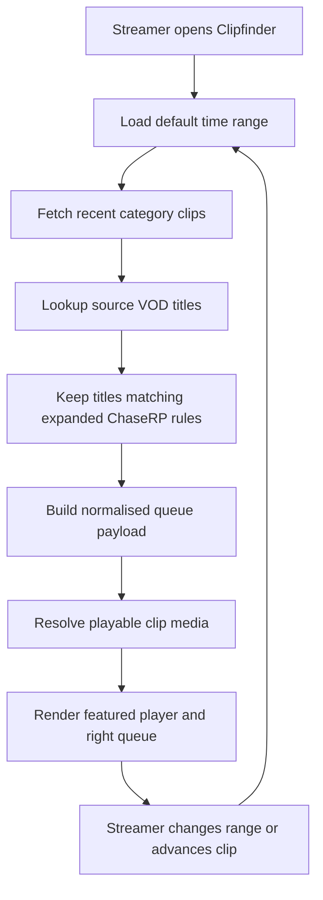

## 1. Product Overview
Clipfinder is a desktop-first Twitch clip queue web app for on-stream use at `clips.teewee.live`. It surfaces clips from a configurable recent time window across a broader Twitch category feed and only keeps clips whose source stream title matches the expanded ChaseRP title rules, regardless of capitalisation.

- Main purpose: give the streamer a clean, fast queue for reviewing and playing community clips without opening Twitch itself.
- User value: reduces manual clip hunting, keeps the stream presentation polished, and makes it easier to highlight the right RP moments quickly.

## 2. Core Features

### 2.1 Feature Module
1. **Clip Queue Page**: queue controls, featured player, clip metadata, right-hand queue list.
2. **Configuration Surface**: time-range selector for past `24h`, `3d`, `7d`, or `30d`, refresh controls, queue ordering, and lightweight stream-safe settings.
3. **Server Fetch Layer**: Twitch category clip retrieval, VOD title lookup, title-based filtering, and normalised payload shaping for the UI.

### 2.2 Page Details
| Page Name | Module Name | Feature description |
|-----------|-------------|---------------------|
| Clip Queue Page | Header rail | Shows app identity, discovery mode, active time range, queue totals, and last refresh state |
| Clip Queue Page | Primary player | Large left-side app-controlled video player for the selected clip with autoplay for queued browsing, clear playback controls, and no dependence on the Twitch iframe login wall |
| Clip Queue Page | Featured metadata | Shows clip title, creator, creation time, clip length, view count, source stream title, and direct Twitch link |
| Clip Queue Page | Queue list | Shows the remaining clips in a right-hand panel with thumbnail, creator, clip title, created time, and views |
| Clip Queue Page | Filter controls | Switches between `24h`, `3d`, `7d`, and `30d`, refreshes results, and exposes queue sorting |
| Clip Queue Page | Queue actions | Allows next/previous clip, mark watched, remove from local queue, and optionally open on Twitch in a new tab |
| Clip Queue Page | Empty state | Explains when no clips match the stream-title filter and suggests refreshing or widening the date range |
| Clip Queue Page | Error state | Explains missing API credentials, Twitch rate limits, partial data caused by clips without VOD linkage, or media-resolution failures for individual clips |

## 3. Core Process
The streamer opens `clips.teewee.live`, the app loads the default time range, and the server requests recent clips from Twitch using a broader category feed rather than a single broadcaster. For each clip with a valid source VOD reference, the server checks the originating stream title and keeps only clips whose source title matches the expanded ChaseRP ruleset. The UI selects the first clip automatically, requests a direct playable media source for that clip from the app backend, renders it in a native video player, and fills the right-hand queue with the rest. The streamer can swap time windows, refresh the feed, move through the queue, and remove clips locally during the session without affecting Twitch.

## 4. User Interface Design
### 4.1 Design Style
- Primary colours: near-black charcoal, muted graphite, and deep green glow accents taken from the existing `teewee.live` presentation
- Secondary colours: soft zinc greys, frosted glass whites, and a restrained neon green for active states
- Button style: translucent ghost pills with rounded full borders, subtle glow on hover, and crisp uppercase labelling
- Font direction: clean modern sans-serif for utility text, with a slightly more characterful display treatment for key labels if it still feels consistent with `teewee.live`
- Layout style: split-screen desktop layout with a dominant media area on the left and a dense control-and-queue rail on the right
- Icon style: simple monochrome utility icons, no playful emoji, no third-party branding clutter

### 4.2 Page Design Overview
| Page Name | Module Name | UI Elements |
|-----------|-------------|-------------|
| Clip Queue Page | Shell | Full-height dark canvas, animated background texture, soft radial glow, thin separators, and floating glass panels |
| Clip Queue Page | Primary player | Large 16:9 native video surface, framed by subtle border glow and stream-safe spacing, with app-owned loading and error states |
| Clip Queue Page | Metadata strip | Clip title, creator avatar or initial, creator name, view count, created date, duration, and source stream title |
| Clip Queue Page | Control pills | Time-range selector, refresh, next clip, previous clip, local remove, and open-on-Twitch action |
| Clip Queue Page | Queue rail | Scrollable right-side list with thumbnail cards, watched state, active highlight, and quick stats |
| Clip Queue Page | States | Distinct loading shimmer, empty queue copy, and credential or Twitch API warning banners |

### 4.3 Responsiveness
Desktop-first because the page is intended for streaming and OBS/browser-source usage. On narrower widths, the layout should stack with the player first and the queue beneath it, while preserving the right-rail density and avoiding accidental clipping of controls. Touch support should remain functional, but the primary experience is keyboard-and-mouse on desktop.

## 5. Product Rules And Constraints
- Time range options are fixed to `24h`, `3d`, `7d`, and `30d`.
- Stream title matching is case-insensitive and should accept these source-title variants: `chaserp`, `chase rp`, `chase roleplay`, `chaseroleplay`, `chase-rp`, `chase-roleplay`, `#chaserp`, `!chaserp`, `chase_rp`, and `chase_roleplay`.
- Clips without a reliable source VOD title should be excluded by default, because the app cannot prove they came from a matching stream.
- Clip discovery should avoid a manual streamer allow-list and instead use a best-effort Twitch-wide proxy such as category-based retrieval.
- The queue cannot guarantee every matching Twitch clip, because Twitch does not expose a true global clip-by-title search endpoint.
- The queue is read-only against Twitch; local actions only change the session state in the browser.
- Playback should prefer app-controlled media delivery instead of the Twitch clip iframe so mature GTA V clips are not blocked by the embed login wall during stream use.
- If direct media resolution fails for an individual clip, the UI should surface that clearly and still offer the Twitch page as a manual fallback.
- The app should feel safe for on-stream display: avoid noisy admin UI, debug dumps, or secret leakage.
- Branding and styling should feel like a sibling product to `teewee.live`, not a generic dashboard.
