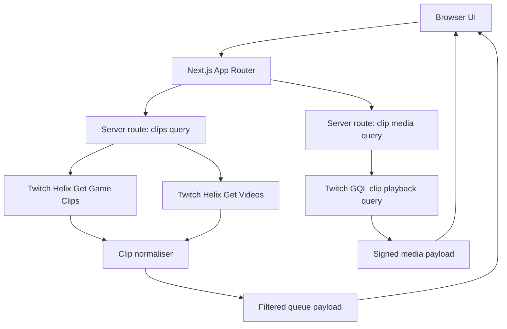
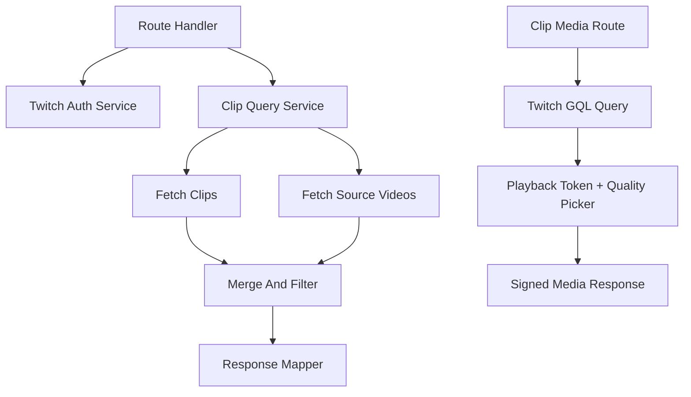
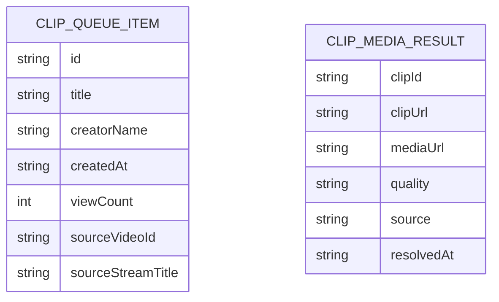

## 1. Architecture Design



## 2. Technology Description
- Frontend: Next.js 16 + React 19 + TypeScript + Tailwind CSS 4
- Runtime model: App Router with server components for initial shell and route handlers for Twitch data access and clip-media resolution
- Data source: Twitch Helix API using app access token flow and category-based clip discovery
- Deployment target: `clips.teewee.live`, compatible with Vercel-style deployment
- Styling direction: custom CSS variables and utility classes aligned with the dark `teewee.live` visual language

## 3. Route Definitions
| Route | Purpose |
|-------|---------|
| `/` | Main clip queue page with player, metadata, queue rail, and controls |
| `/api/clips` | Returns filtered Twitch clips for the requested time range |
| `/api/clip-media` | Resolves a direct playable media URL for a selected clip |

## 4. API Definitions

### 4.1 `GET /api/clips`
Query parameters:

```ts
type TimeRange = '24h' | '3d' | '7d' | '30d';

interface GetClipsQuery {
  range?: TimeRange;
}
```

Response shape:

```ts
interface ClipQueueItem {
  id: string;
  url: string;
  title: string;
  creatorName: string;
  creatorId: string;
  thumbnailUrl: string;
  createdAt: string;
  durationSeconds: number | null;
  viewCount: number;
  broadcasterId: string;
  broadcasterName: string;
  sourceVideoId: string | null;
  sourceStreamTitle: string;
  matchesFilter: true;
}

interface ClipQueueResponse {
  range: TimeRange;
  refreshedAt: string;
  totalFetched: number;
  totalEligible: number;
  excludedWithoutVideo: number;
  filteredOutByTitle: number;
  items: ClipQueueItem[];
}
```

### 4.2 `GET /api/clip-media`
Query parameters:

```ts
interface GetClipMediaQuery {
  clipUrl: string;
}
```

Response shape:

```ts
interface ClipMediaResponse {
  clipId: string;
  clipUrl: string;
  mediaUrl: string;
  quality: string;
  source: "twitch-gql";
  resolvedAt: string;
}
```

Error shape:

```ts
interface ApiErrorResponse {
  error: string;
  message: string;
  details?: string;
}
```

## 5. Server Architecture Diagram



## 6. Data Model

### 6.1 Data Model Definition



### 6.2 Data Definition Notes
- No database is required for the first version.
- Queue data is assembled on demand from Twitch and kept in memory per request.
- Client-side session state may track the currently selected clip, watched items, and locally removed items.

## 7. Twitch Integration Notes
- Required environment variables:

```ts
interface Env {
  TWITCH_CLIENT_ID: string;
  TWITCH_CLIENT_SECRET: string;
  TWITCH_GAME_ID: string;
}
```

- Authentication uses the Twitch app access token flow and caches the token until expiry.
- Clip fetching uses the Twitch game/category ID plus chunked time slices rather than one broad window, so larger ranges retain the same recent buckets as smaller ranges before older buckets are added.
- Stream-title filtering requires a second pass over unique `video_id` values via Twitch video lookup, because clip records alone do not reliably contain the full source stream title.
- Some clips may not expose a usable `video_id`; those clips are excluded and counted in the response so the UI can explain partial results.
- Filtering logic uses a case-insensitive title matcher that accepts these variants: `chaserp`, `chase rp`, `chase roleplay`, `chaseroleplay`, `chase-rp`, `chase-roleplay`, `#chaserp`, `!chaserp`, `chase_rp`, and `chase_roleplay`.
- This is a best-effort global discovery strategy, not a complete Twitch-wide search, because Twitch does not expose clip search by source title across all streamers.
- Media playback should not rely on the Twitch clip iframe. Instead, the app should call Twitch's clip GraphQL endpoint server-side, request `playbackAccessToken` plus `videoQualities`, choose a stable quality tier, and return a signed direct video URL to the browser for native playback.
- Clip media responses should be treated as ephemeral and resolved on demand, because Twitch asset URLs may expire or rotate.

## 8. UI State Strategy
- Initial server render provides the first queue payload for a fast first paint.
- Client state manages active clip selection, queue advancement, local removal, media fetches for the selected clip, playback-failure countdown skips, and refreshes when the time range changes.
- The right rail remains scrollable independently so the featured player stays in place during longer review sessions.
- Error boundaries and clear empty states keep the page usable during Twitch outages, credential issues, or clip-media resolution failures.

## 9. Performance And Stream Safety
- Limit Twitch requests by deduplicating source video lookups before filtering.
- Cache resolved clip media for a short window in memory to avoid repeated clip-page fetches during normal queue browsing.
- Keep animations lightweight and background effects CSS-driven so OBS/browser-source capture remains stable.
- Preserve smooth next-clip transitions with the native player while still handling browser autoplay restrictions gracefully.
- If a clip resolves but the native player still errors, surface that state clearly and auto-advance after a short countdown so stream playback does not stall.
- Ensure the visible layout fits cleanly in 16:9 stream scenes with no clipped controls at common OBS browser-source sizes.
